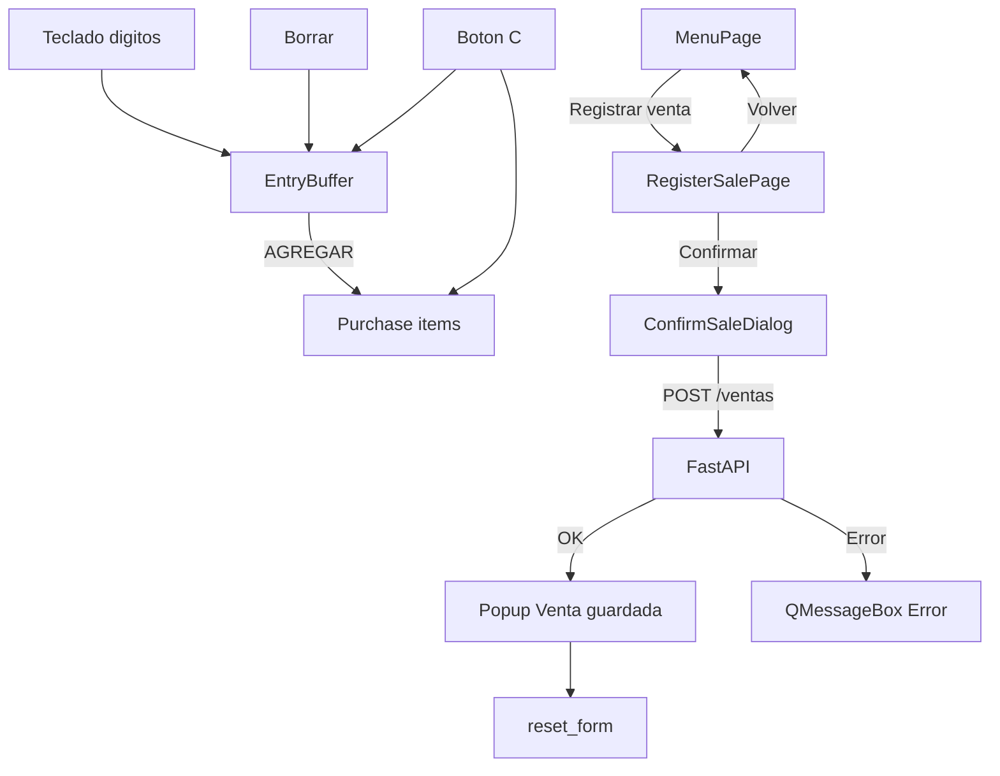

# Plan Beta 1.1 — Documentación y desarrollo

Este archivo se escribió **antes** de implementar Beta 1.1 y se fue marcando por etapas. La sección 1 (diagnóstico) y la sección 7 (guía visual de entonces) describen el código de ese momento: calculadora con `+` y `−`, sin botón Volver, sin popup de éxito y ventana pequeña con `resize`. Eso ya no es el estado del programa. El estado actual está en `docs/architecture.md` y `docs/beta-1.1/visual-guide.md`. Las etapas 0 a 7 quedaron hechas.

## Respuesta rápida a tus decisiones

**Conservar datos al volver (opción B):** no es complicado. `MainWindow` ya mantiene una sola instancia de `RegisterSalePage` dentro del `QStackedWidget`. Al cambiar de página el widget no se destruye; el estado en memoria (calculadora + compra) permanece si **no** se llama `reset_form()` al salir. Solo hace falta un método `go_back_to_menu` que haga `setCurrentWidget(self._menu)` sin limpiar. Al reentrar, `open_register_sale` puede recargar medios de pago y mostrar la misma página con la compra intacta.

**Formato monetario:** se mantiene el actual `format_cop` → `$ 5.000` (con espacio), ya usado en código y pruebas. No se cambia el separador ni el símbolo.

---

## 1. Diagnóstico del proyecto actual

### Arquitectura real (alineada con docs)

```text
PySide6 (desktop/ui.py)
  → ApiClient HTTP (desktop/client.py)
    → FastAPI (api/app.py)
      → app/sales.py
        → persistence (SQLite)
```

- Calculadora local en [`bakery/app/calculator.py`](bakery/app/calculator.py): tokens con `+`/`-`, `clear`, `backspace`.
- Dinero entero; presentación en [`bakery/app/money.py`](bakery/app/money.py).
- Persistencia: solo total de venta (`valor_total`) + medio de pago. Sin líneas de detalle.
- API: `GET /health`, `GET /medios-pago`, `POST /ventas` `{valor_total, id_medio_pago}`.
- Desktop: menú → registrar venta; tras guardar se queda en registro y hace `reset_form()`. Sin botón volver. Sin popup de éxito (solo error con `QMessageBox`).
- Estilos: **ningún** `setStyleSheet` / tipografía custom; solo layouts Qt + `objectName` + `resize(420, 560)`.

### Relación con Beta 1.1

| Cambio | Impacto |
|--------|---------|
| Lista de compra | Solo memoria/desktop + capa `app`. **Sin** cambios de BD/API. |
| Quitar `+`/`−`, AGREGAR, Borrar, C | Reescribir modelo de calculadora + UI pad + tests stage2/stage4 |
| Formato en tiempo real | UI + entrada actual; reutilizar `format_cop` |
| Popup éxito | Solo desktop, post-`POST` exitoso |
| Volver al menú | Solo navegación; estado se conserva por diseño actual del stack |
| Visual | Preparar hooks/guía; Daniel ajusta valores manualmente |

### Discrepancias docs vs código (menores)

- Stages dicen 2 endpoints; el código también tiene `GET /health` (arranque).
- Stage 5 marcada “Pendiente” aunque el arranque unificado ya existe.
- PRD Beta 1 describe calculadora con `+`/`−`; Beta 1.1 lo reemplaza.

---

## 2. Decisiones técnicas (acordadas / propuestas)

| Decisión | Resolución |
|----------|------------|
| Lista temporal de compra | En memoria en capa `app` (nuevo modelo). No tablas nuevas. |
| Separación de estado | **Entrada actual** (dígitos) ≠ **líneas de compra** (`List[int]`) ≠ total |
| Calculadora / HTTP | Sigue local; HTTP solo al confirmar venta |
| `POST /ventas` | Sin cambios: se envía el **total acumulado** |
| AGREGAR inválido (vacío / 0) | **No-op silencioso** (coherente con submit deshabilitado hoy; sin diálogo nuevo) |
| Borrar | Solo dígito de la entrada actual (equivalente a `backspace` actual) |
| C | Limpia compra + entrada; no toca medio de pago (salvo que se limpie en reset post-venta) |
| Volver | Conserva compra y entrada; no pide confirmación |
| Formato | `$ 5.000` vía `format_cop` existente |
| Estilos | Opcional: constantes mínimas en un solo módulo/archivo; **sin** framework de temas |

### Modelo de dominio propuesto (capa `app`, sin Qt)

```text
EntryBuffer / Calculator (entrada)
  - dígitos, backspace, clear entry, current_amount: Optional[int]
  - display via format_cop mientras se escribe (0 → "$ 0" o vacío según criterio de etapa)

Purchase (compra)
  - items: List[int]  # solo montos; listo para ampliar a productos después
  - add(amount), clear(), total() -> int

RegisterSalePage (UI)
  - orquesta Entry + Purchase
  - submit usa purchase.total()
```

Esto deja limpia una futura ampliación a ítems con nombre/cantidad **sin** implementarla ahora.



---

## 3. Fuera de alcance (Beta 1.1)

- Productos, nombres, cantidades, catálogo, inventario
- Tablas/columnas para líneas de venta
- Nuevos endpoints o endpoint de calculadora
- Edición/eliminación de ventas, reportes, login, sync, PostgreSQL
- Confirmación al abandonar compra pendiente
- Decisiones concretas de color/tipografía/márgenes (las harás tú)

---

## 4. Actualización de documentación (primera acción al ejecutar)

Solo estos archivos; sin inventar sync ni BD:

### [`docs/product-requirements.md`](docs/product-requirements.md)
- Sección **Beta 1.1**: lista de compra, formato en vivo, AGREGAR, Borrar (dígito), C (limpia compra), sin `+`/`−`, popup éxito, botón volver con estado conservado.
- Distinguir requisitos Beta 1 (histórico) vs Beta 1.1 activos.
- Fuera de alcance explícito (productos, etc.).

### [`docs/architecture.md`](docs/architecture.md)
- Flujo desktop actualizado (Entry vs Purchase).
- Responsabilidades AGREGAR / Borrar / C.
- Comunicación API solo al confirmar.
- Popup post-éxito; navegación menú ↔ registro con estado preservado.
- Sin cambios de capas ni de stack.

### [`docs/database.md`](docs/database.md)
- Nota explícita: **Beta 1.1 no requiere cambios de esquema**; la lista es en memoria.

### [`docs/sync.md`](docs/sync.md)
- Nota breve: Beta 1.1 no afecta sincronización (sigue fuera de alcance).

### Opcional: [`docs/beta-1/beta-1-stages.md`](docs/beta-1/beta-1-stages.md) o nuevo `docs/beta-1.1/`
- Marcar Beta 1 cerrada conceptualmente y enlazar al plan de etapas 1.1 (este documento).

**No se modifica código de aplicación en la fase de documentación.**

---

## 5. Plan de desarrollo por etapas

### Etapa 0 — Documentación
- **Objetivo:** alinear docs con Beta 1.1.
- **Archivos:** docs listados arriba.
- **Pruebas:** ninguna (docs).
- **Aceptación:** docs reflejan Entry/Purchase, sin cambios BD/API/sync inventados.
- **Intacto:** todo el código y las 42 pruebas.

### Etapa 1 — Modelo Entry + Purchase (sin UI)
- **Objetivo:** reemplazar el modelo token/`+/-` por entrada + lista.
- **Archivos:** [`bakery/app/calculator.py`](bakery/app/calculator.py) (reorientar o extraer), nuevo módulo p.ej. `bakery/app/purchase.py`; [`tests/test_stage2_application.py`](tests/test_stage2_application.py).
- **Cambios:** `press_digit`, `backspace`, `clear_entry`, `add_to_purchase`, `clear_purchase`, `total`; eliminar `press_add`/`press_subtract` como operadores.
- **Pruebas:** reescribir tests de operadores → acumulación; mantener money + `register_sale_*`.
- **Aceptación:** unit tests verdes; `total` es suma de ítems; AGREGAR inválido no-op.
- **Intacto:** persistence, API, `format_cop`, `register_sale`.
- **Depende de:** Etapa 0 (recomendado).

### Etapa 2 — Formato monetario en tiempo real (lógica + contrato UI)
- **Objetivo:** mientras se escriben dígitos, el valor de entrada se muestra con `format_cop`.
- **Archivos:** modelo de entrada + tests stage2; contrato de display documentado.
- **Pruebas:** `1→$ 1`, `1000→$ 1.000`, borrar hasta `$ 0` o vacío (definir en implementación: preferir mostrar `$ 0` cuando no hay dígitos, o vacío — **default propuesto: vacío si no hay dígitos, `$ X` mientras hay entrada**).
- **Aceptación:** sin HTTP; solo lógica local.
- **Intacto:** `format_cop` firma/resultado.

### Etapa 3 — UI: pad, AGREGAR, Borrar, C, vista Compra
- **Objetivo:** adaptar [`bakery/desktop/ui.py`](bakery/desktop/ui.py).
- **Cambios:** quitar `add_button`/`subtract_button`; botón `AGREGAR` (`agregar_button`); renombrar etiqueta ⌫ → `Borrar` (mantener o renombrar `objectName` a `borrar_button` y actualizar tests); C limpia compra+entrada; widgets para lista (`purchase_list`) y total (`purchase_total`); display de entrada con formato en vivo; submit habilitado si `purchase.total() > 0` y medio seleccionado.
- **Pruebas stage4:** actualizar `test_calculator_keys_do_not_call_api` (sin `add_button`); nuevos tests AGREGAR/lista/C/Borrar; assert ausencia de `+/-`.
- **Aceptación:** flujo ejemplo 5000+3000 → total 8000; C limpia todo; Borrar no toca líneas; 0 HTTP en teclas/AGREGAR.
- **Intacto:** `ApiClient`, confirm dialog previo al POST.

### Etapa 4 — Navegación “Volver”
- **Objetivo:** botón volver en pantalla de registro → menú; estado conservado.
- **Archivos:** `ui.py` (`MainWindow`, `RegisterSalePage`).
- **Pruebas:** volver con compra pendiente y reentrar → mismos ítems/total; volver sin datos → menú ok.
- **Aceptación:** no `reset_form` al volver; sí `reset_form` tras venta exitosa.
- **Intacto:** menú → registrar (carga medios).

### Etapa 5 — Popup “Venta guardada”
- **Objetivo:** tras `POST` exitoso, popup de éxito; luego `reset_form`.
- **Archivos:** `ui.py` (p.ej. `QMessageBox.information` o diálogo simple con `objectName` `sale_saved_dialog`).
- **Flujo:** Confirmar → POST → éxito → popup → limpiar → listo en registrar.
- **Pruebas:** éxito muestra popup; error HTTP **no** muestra éxito; cancelar confirmación no guarda ni popup; actualizar `test_confirm_sale_posts_and_resets_form` / happy path.
- **Intacto:** `ConfirmSaleDialog` sigue siendo la confirmación *antes* del POST.

### Etapa 6 — Preparación visual (sin decidir diseño)
- **Objetivo:** facilitar ajustes manuales tuyos.
- **Propuesta mínima:** constantes de tamaño/espaciado en un solo sitio (p.ej. arriba de `ui.py` o `bakery/desktop/style.py` con enteros/`QSize`/márgenes) + `objectName`s estables; **no** inventar paleta.
- **Aceptación:** guía en docs/plan (sección 6 abajo); cero cambio visual obligatorio.

### Etapa 7 — Regresión completa
- Hecha el 2026-10-19. Suite completa en verde: 61 pruebas (`QT_QPA_PLATFORM=offscreen python3 -m pytest`).
- No se borraron tests para que pasara; solo se adaptaron los de comportamiento cambiado a propósito en las etapas anteriores.

---

## 6. Mapa de pruebas

### Se mantienen (~22)
- Stage 0 completo; Stage 1 completo; Stage 3 completo (incl. `test_no_calculator_endpoint`).
- Stage 2: `format_cop*`, `register_sale_*`.
- Stage 4: menú abre registro (ajustar solo si cambian objectNames).

### Se actualizan (~12–15)
- Stage 2: todos los tests de `+/-`, expresión incompleta, clear/backspace ligados a operadores.
- Stage 4: pad HTTP, confirm/reset/happy path (lista + popup + objectNames).

### Nuevas (mínimo)
- Unit: AGREGAR uno/varios; total; AGREGAR inválido; C limpia compra; Borrar dígito hasta vacío; formato progresivo; sin operadores.
- Desktop: sin `+/-`; AGREGAR sin HTTP; C vs Borrar; popup éxito / no en error; volver conserva estado; submit usa total de compra.

---

## 7. Guía de personalización visual (para ti después)

Hoy no hay estilos centralizados. Controles útiles:

| Qué quieres cambiar | Dónde | Cómo |
|---------------------|-------|------|
| Tamaño ventana | `MainWindow.__init__` en [`ui.py`](bakery/desktop/ui.py) | `self.resize(420, 560)` |
| Orden vertical registro | `RegisterSalePage.__init__` | orden de `layout.addWidget(...)` |
| Posición teclas | lista `buttons` + `QGridLayout` `(row, col)` | mover tuplas |
| Tamaño botones | cada `QPushButton` del pad | `setFixedSize(w, h)` o `setMinimumSize` |
| Espaciado | layouts | `setSpacing`, `setContentsMargins` |
| Colores / tipografía | hoy: defaults Qt | `setStyleSheet` por widget o por `objectName` (`#sale_display { ... }`) |
| Texto botones | literales `"AGREGAR"`, `"Borrar"`, `"C"`, etc. | strings en `ui.py` |

`objectName`s actuales (y previstos): `sale_display`, `sale_expression`→posiblemente `purchase_list` / `purchase_total`, `digit_*`, `clear_button`, `backspace_button`/`borrar_button`, `agregar_button`, `payment_combo`, `submit_sale_button`, `menu_register_button`, `confirm_*`, nuevo `back_button`, `sale_saved_dialog`.

**Recomendación ligera:** en Etapa 6, un diccionario/constantes `PAD_BUTTON_MIN_SIZE`, `WINDOW_SIZE`, márgenes — sin QSS obligatorio. Tú puedes añadir QSS después sobre esos `objectName`s.

---

## 8. Archivos afectados (implementación futura)

| Archivo | Rol |
|---------|-----|
| `docs/*.md` | Requisitos / arquitectura / BD / sync |
| `bakery/app/calculator.py` (+ posible `purchase.py`) | Estado Entry/Purchase |
| `bakery/desktop/ui.py` | Pad, lista, navegación, popup |
| `tests/test_stage2_application.py` | Unit calculadora/compra |
| `tests/test_stage4_desktop.py` | UI / HTTP / navegación / popup |
| **Sin tocar (salvo regresión):** | `api/app.py`, `persistence/*`, `sales.py`, `client.py`, `money.py` (firma) |

---

## 9. Riesgos / pendientes menores

- Etiqueta exacta del botón volver (p.ej. `"Volver"`) — default `"Volver"`.
- Si la entrada vacía muestra `""` o `$ 0` — default: `""` sin dígitos.
- Recargar medios al reentrar puede resetear el índice del combo si la lista se reconstruye: en Etapa 4 hay que **preservar la selección de medio** al recargar (guardar `id` seleccionado y restaurarlo), para no perder medio junto con la compra conservada.
- Stage 5 de Beta 1 en stages.md: actualizar estado documental, no rehacer integración.

---

## Orden de ejecución al aprobar este plan

1. Actualizar documentación (Etapa 0).
2. Implementar etapas 1→7 en orden, con pruebas verdes al cierre de cada etapa.
3. **No** implementar funcionalidades de producto fuera de alcance.

Esta tarea de planificación **no implementa** todavía las funcionalidades; la implementación arranca cuando apruebes el plan.
